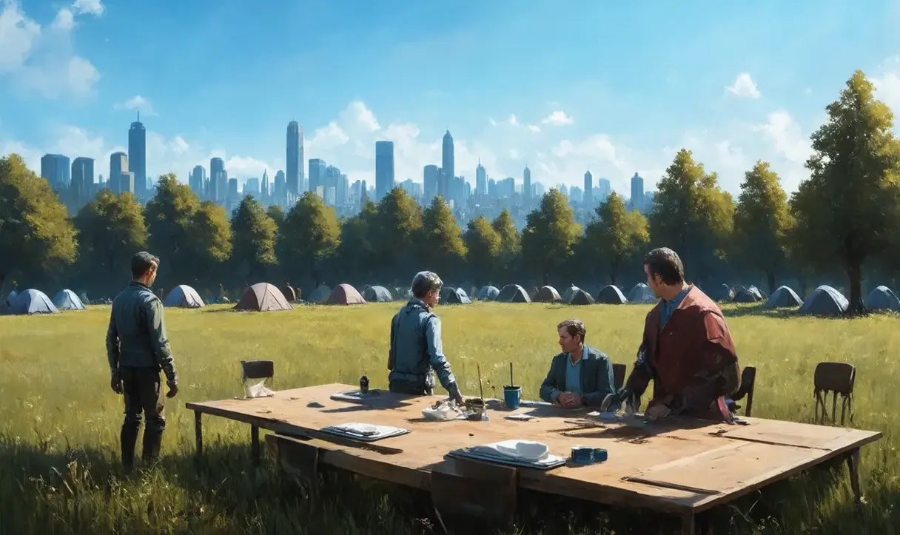

# Steel Sky

A working studio pipeline for a catalogue of 440 fiction screenplay projects and their graphic novel adaptations.

> **Based on [AbdBarho/stable-diffusion-webui-docker](https://github.com/AbdBarho/stable-diffusion-webui-docker).** The Docker services, `docker-compose.yml`, `LICENSE` and the AUTOMATIC1111 and ComfyUI setup come from that project. Steel Sky adds the catalogue, the pilot projects, the manifest runner and the experiment site on top. For installation and troubleshooting, use the upstream [wiki](https://github.com/AbdBarho/stable-diffusion-webui-docker/wiki).

The repository holds three things:

1. **The catalogue.** 440 screenplay projects in 22 cycles of 20, each illustrating a mathematical or conceptual framework.
2. **Pilot packages.** A treatment, scene outline, screenplay and visual bible for each project on the first slate. Two are finished.
3. **The image pipeline.** A local ComfyUI service driven by JSON manifests, used to test whether a small Stable Diffusion model can produce usable art for those visual bibles.

Earlier experiments in this repository (the Preliminary Run below, the image rater, and the large Blastoids, Macrolife and Aniara runs) are kept as an archive and described near the end.

## Preliminary Run

The first test of the local pipeline, before the catalogue work began. Full-size files are in `output/comfy` locally.




## Getting started

### Requirements

- Docker with Compose v2.
- An NVIDIA GPU with the NVIDIA Container Toolkit, for the `comfy` profile. Without a GPU, use `comfy-cpu` instead, which is much slower.
- Python 3.8 or newer on the host. The runner uses only the standard library. `tools/make_thumbs.py` needs `pip install pillow`.
- About 10 GB of free disk for the images and model files.

### Install

```
git clone https://github.com/standardgalactic/steel-sky
cd steel-sky

# 1. download the model files (first time only)
docker compose --profile download up --build

# 2. start ComfyUI
docker compose --profile comfy up --build
```

ComfyUI is then available at http://localhost:7860. Models are stored in `data/models/`, and generated images appear in `output/comfy/`. Stop it with Ctrl+C, or `docker compose --profile comfy down` from another terminal. The experiments use the Stable Diffusion 1.5 checkpoint `v1-5-pruned-emaonly.ckpt`, which the download profile fetches. Other profiles (`auto`, `auto-cpu`, `comfy-cpu`) and troubleshooting are covered in the upstream wiki.

### Run an experiment

Keep ComfyUI running, and run the commands below from the repository root in another terminal. The runner expects `generate.py` and `workflow.json` in the working directory and talks to `http://127.0.0.1:7860`. Override these with `--generator`, `--workflow` and `--url`.

1. **Write a manifest.** Copy `manifests/slate-samples-v4.json`, change `name`, and edit the categories and items. The format is described under "The image pipeline" below. Use a new `name` for each run so its images land in a separate folder.
2. **Check the prompts without generating:**
   ```
   python generate_collection.py manifests/my-run.json --dry-run
   ```
   The first line gives the job count and total images, and each job shows the full prompt and negative prompt.
3. **Generate.** Add `--category 03.01` to run one project only, and repeat the flag for several:
   ```
   python generate_collection.py manifests/my-run.json --category 03.01
   ```
   Images are saved to `output/comfy/my-run/<category>/<item>/`.
4. **Resume or retry.** Progress is saved in `<manifest-name>.progress.json` beside the manifest, and a re-run skips finished jobs. If a run was interrupted, the runner stops instead of risking a duplicate. Check the ComfyUI queue, then add `--retry-incomplete` to submit that job again. This may duplicate images.
5. **Build previews and view them:**
   ```
   python tools/make_thumbs.py output/comfy --dst thumbs --size 512 --quality 80
   python -m http.server
   ```
   Open http://localhost:8000 to see the new run on the site. Commit `thumbs/`, not `output/`.

Practical limits: batch 4 at 512 x 512 fits modest GPUs, and lowering `defaults.batch` to 1 reduces memory use. A change to a shared prompt re-generates the affected jobs into the same folder.

### Optional: the Arch tooling container

The Python tools can also run in an Arch Linux container, named after the `archdaemon` branch. ComfyUI stays in its own container. Add the `arch` service from `services/arch/compose-snippet.yml` to `docker-compose.yml`, start ComfyUI as above, then:

```
docker compose --profile arch up --build -d
docker compose exec arch bash
```

The project folder is mounted at `/work`, and the container runs as a user with your ids, so files it writes are yours. Reach ComfyUI at `http://host.docker.internal:7860`, which the container sets in `$COMFY_URL`:

```
python generate_collection.py manifests/my-run.json --url "$COMFY_URL"
```

Set `PUID` and `PGID` in the environment if your ids are not 1000. On Linux, `host.docker.internal` is provided by the `extra_hosts` line in the snippet. Stop it with `docker compose --profile arch down`.

## 1. The catalogue

`catalogue/catalogue.md` lists all 440 entries once each. Every entry has a title, a framework (mathematical, conceptual or both), a scale (S, M or L) and a graphic treatment note.

| Count | |
|---|---|
| Entries | 440 (22 cycles of 20) |
| Scale | S 194, M 230, L 16 |
| Framework kind | Mathematical 280, mixed 82, conceptual 78 |

Two audits keep the set varied:

- `catalogue/framework-family-audit.md` assigns every entry to one of 26 framework families and enforces an 8 percent cap, which is at most 35 entries per family. The assignments are in `framework-family-assignments.csv`.
- `catalogue/graphic-treatment-audit.md` checks that adaptation treatments are spread across the set. Assignments are in `graphic-treatment-assignments.csv`.

## 2. Pilot projects

The first slate is 01.01, 03.01, 04.01, 07.01, 08.01 and 11.01. Each pilot is developed in the same order: treatment, scene outline, screenplay, visual bible.

| Slot | Title | Framework | Status |
|---|---|---|---|
| 03.01 | The Last Projectionist | Inverse problem: reconstructing a screening history from a missing reel | Complete |
| 01.01 | The Department of Unclaimed Rooms | Map versus territory, classification | Complete |
| 04.01 | The Society for Perfect Endings | | Not started |
| 07.01 | Whale Beneath the Railway | | Not started |
| 08.01 | Seven Minutes of Summer | | Not started |
| 11.01 | A Country Made of Footnotes | | Not started |

Files for finished pilots are in `projects/03.01/` and `projects/01.01/`.

### Expanding the catalogue

The catalogue is one file, `catalogue/catalogue.md`, with 22 cycle sections of 20 projects each. To add or change a project:

1. **Write the entry.** Cycle 01 uses the full schema (title, cycle and slot, premise, framework, conditions, the protagonist's misunderstanding, graphic treatment, scale). Cycles 02 onward use the compact one-line format described under "Compact entry format" in the file. Copy a neighbouring entry in the same cycle and keep its layout.
2. **Keep the slot unique.** Slots run `CC.NN`, for example `03.01`, and each title appears once in the file.
3. **Respect the framework cap.** No framework family may hold more than 8 percent of the catalogue, which is 35 of 440. The family of every entry is in `catalogue/framework-family-assignments.csv`. Add a row for a new entry and count the family before you commit. The reasoning is in `framework-family-audit.md`.
4. **Give it a graphic treatment** and a row in `graphic-treatment-assignments.csv`, so the visual approaches stay spread across the set. See `graphic-treatment-audit.md`.
5. **Develop the project in four steps,** in this order, one project at a time: treatment (with the ending resolved), scene outline, screenplay, visual bible. Save them in `projects/<slot>/` with the slot first in the file name, for example `04.01-the-society-for-perfect-endings-treatment.md`.
6. **Test its look.** Add a category to a new manifest, put the visual bible's medium and light in the category prompt, and add the six standard items: palette-test, lead-character, main-location, key-object, core-device and page-layout. The findings above say which of those the generator can draw. Update the pilot table in this README when a project reaches a new stage.

The two audits were produced with one-off scripts that are not in this repository, so for now they are re-checked by counting the CSV rows.

## 3. The image pipeline

### What it does

`generate_collection.py` reads a JSON manifest and submits each item to a local ComfyUI service through `generate.py`. A manifest holds a shared prompt, defaults, and categories, one per project, each with its own visual language and a list of items.

The prompt for each image is composed from the item prompt, then the category prompt, then the shared prompt. The negative prompt and seed come from the defaults. Per-item seeds are derived from the base seed and a hash of the output path, so a re-run reproduces the same images.

### Manifest format

```json
{
  "name": "slate-samples-v4",
  "shared_prompt": "graphic novel interior art, hand drawn, flat 2d illustration",
  "defaults": { "batch": 3, "variations": 1, "seed": 20261005, "negative": "text, watermark, photograph" },
  "categories": {
    "03.01": {
      "prompt": "charcoal drawing, heavy black shadows, worn film print texture",
      "items": [ { "name": "key-object", "prompt": "close up of a ribbon of film with small square holes along both edges" } ]
    }
  }
}
```

### Manifest options and behaviour

- **Jobs.** Each item gets `variations` separately seeded variants, and each variant is one job of `batch` images. With `batch` 3 and `variations` 2, an item makes 6 images in 2 jobs. Lower `defaults.batch` to 1 for less GPU memory, or `defaults.variations` to 1 for a smaller run.
- **Overrides.** A category or an item can override the defaults with a `settings` object, for example `"settings": {"batch": 2, "variations": 3, "seed": 42}`. An item's `negative` adds exclusions to the inherited negative prompt. To replace the negative for a whole category, put it inside that category's `settings`.
- **Output names.** ComfyUI saves images with prefixes such as `slate-samples-v4/03-01/key-object/variant-001`, so they appear under `output/comfy/slate-samples-v4/`. Change `name` to start a separate run folder.
- **Default manifest.** With no manifest argument the runner reads `collection.json`, the original 32-item example kept from the earlier setup.
- **Progress file.** `<manifest-name>.progress.json` records finished jobs. A re-run skips a job when its prompts, seeds, batch settings, workflow bytes and server URL all match. It does not check that the saved images still exist, so delete the matching entry (or the file) to regenerate. Do not run two copies against the same progress file at once.
- **Interrupted jobs.** The runner stops rather than submit a possible duplicate. Check the ComfyUI queue and the output folder first, then use `--retry-incomplete` to submit that job again. This can duplicate images. If a job was accepted by the server but the client failed before recording it, reconcile it by hand or accept the duplicates.
- **Changing prompts.** Changing the shared prompt regenerates the affected jobs into the same folders, and ComfyUI normally allocates new file names. Seeds are deterministic for each category, item and variant, but a different batch size or other settings can change the images.
- **Limits.** A shared prompt gives visual coherence, not identical faces between scenes. Recurring identity needs a reference-image or character-conditioning workflow, which this setup does not have. Very long prompts can dilute specific details, so check a small category before a big run.
- **What the runner controls.** Sampler, size, steps, CFG and checkpoint come from `workflow.json`. The runner supports the options of `generate.py`, and it does not do image-to-image or change the workflow.

### Running it

See "Run an experiment" under Getting started. In short: write a manifest, check it with `--dry-run`, generate, then build thumbnails. Images are saved under `output/comfy/<manifest-name>/<category>/<item>/`. ComfyUI embeds the full prompt in every PNG, so any image can be traced back to its job from the file alone.

### Setup used for the test

Stable Diffusion 1.5 (`v1-5-pruned-emaonly.ckpt`) in Docker, 512 x 512, 20 steps, CFG 8, Euler sampler, normal scheduler, denoise 1. No reference images and no LoRAs.

### Findings from four runs (80 images)

| Run | Purpose | Images |
|---|---|---|
| v1 | First pass at six items per project | 12 |
| v2 | Rewrote prompts to remove negation and abstract devices | 24 |
| v3 | Full-bleed prompts, four seeds, no device items | 32 |
| v4 | Targeted fixes for four weak items | 12 |

What works with a model this size:

- Medium and texture: charcoal with worn print grain, ink linework with flat wash.
- Casting studies. Portraits are good but are not stable identities between seeds.
- Locations and single props, when the prompt names a simple subject and a viewpoint.
- A named film strip, as "a long thin ribbon of film with a row of small square holes along both edges".

What fails and is handled outside the generator:

- Relational devices, such as a film frame growing out of a drawing or stacked tracing sheets in different inks. These are built as vector assets (`projects/*/assets/`).
- Selective colour. Naming one object's colour sometimes works but cannot be held to that object.
- Lettering, panel layouts and exact numbers. These are added in code after generation.
- Anything stated as a negation in the positive prompt. The model draws the thing instead.

Practical prompt rules that came out of the test:

- Put the subject and viewpoint first, the medium second.
- Ask for "full bleed drawing that fills the entire image" and block frames, mats and gallery walls in the negative prompt, or the model draws a framed print.
- Four seeds per portrait or location give a real choice. One seed does not.

## Repository layout

```
catalogue/        the 440-entry catalogue, audits and assignment tables
projects/         pilot packages and their assets, one folder per slate project
manifests/        image manifests (slate-samples through v4)
tools/            make_thumbs.py and older helper scripts
thumbs/           compressed previews and prompt indexes (generated, committed)
samples/          selected full-quality picks (committed)
output/           raw ComfyUI output (not committed)
services/ data/   upstream Docker services and model folders
```

## Previews and the archive

Raw output is not committed. Run

```
python tools/make_thumbs.py output/comfy output/old --dst thumbs
```

to build 192 px WebP previews, a `index.jsonl` of prompts and seeds for every image, and contact sheets of 400 images each. A thumbnail is about 3 KB, roughly 150 times smaller than the PNG it came from.

The archive in `output/old` holds about 12,000 images from earlier runs: Blastoids (5,100), ComfyUI test runs (4,100), Macrolife (1,000), Aniara (1,000), Steel-sky (887) and a small Political Art set, plus the curation and description tools that were used on them.

## Upstream setup and features

This repository keeps the upstream services for two UIs:

- [AUTOMATIC1111](https://github.com/AUTOMATIC1111/stable-diffusion-webui), with its [feature list](https://github.com/AUTOMATIC1111/stable-diffusion-webui-feature-showcase).
- [ComfyUI](https://github.com/comfyanonymous/ComfyUI), with its [feature list](https://github.com/comfyanonymous/ComfyUI#features). The pipeline above uses this one.

For installation, GPU and model download instructions, see the upstream [Setup](https://github.com/AbdBarho/stable-diffusion-webui-docker/wiki/Setup) and [Usage](https://github.com/AbdBarho/stable-diffusion-webui-docker/wiki/Usage) wiki pages, and the [FAQ](https://github.com/AbdBarho/stable-diffusion-webui-docker/wiki/FAQ) if something goes wrong.

## History and provenance

The first 237 commits are the upstream project's real history, with its real authors. The Steel Sky work was added on top of them from the finished files, one small step at a time, with `tools/monotonic_commit.py`. Those later commits carry real timestamps from the day they were made, so they describe how the files are built up, not when they were first written. Every file is classified against upstream in `PROVENANCE.md` and `provenance.csv`, and commits that touch an upstream file name its remaining authors in their trailers.

## Contributing

Contributions are welcome. Open a discussion about the problem and the change you want to make before implementing anything.

## Disclaimer and license

The authors are not responsible for content generated with this interface. The license inherited from upstream forbids sharing content that violates laws, causes harm to a person, discloses personal information meant for harm, spreads misinformation or targets vulnerable groups. See `LICENSE` for the full restrictions.

## Thanks

See [CONTRIBUTORS.md](CONTRIBUTORS.md) for the people whose commits make up the upstream project's history.


Steel Sky is based on [AbdBarho/stable-diffusion-webui-docker](https://github.com/AbdBarho/stable-diffusion-webui-docker), and thanks go to its maintainers. Thanks also to the projects that repository builds on: AUTOMATIC1111/stable-diffusion-webui, ComfyUI, CompVis/stable-diffusion, InvokeAI and Sygil-webui.
